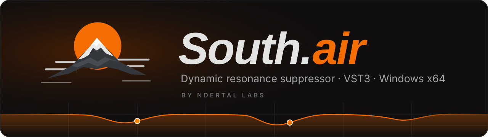
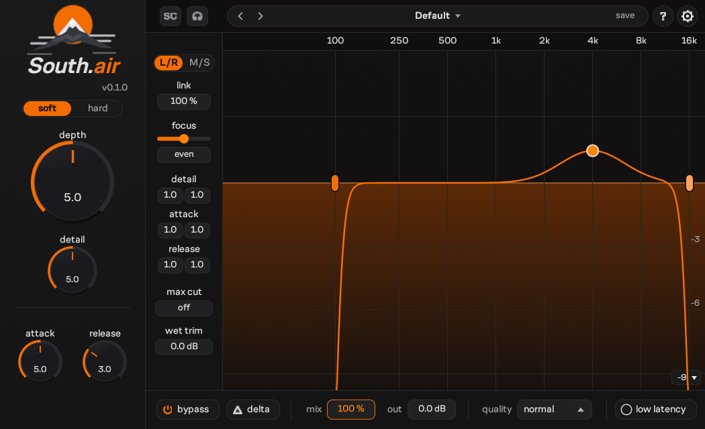
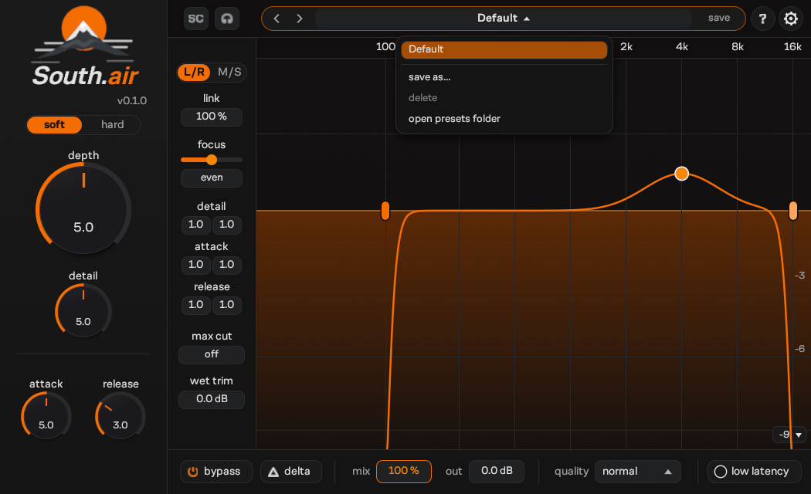
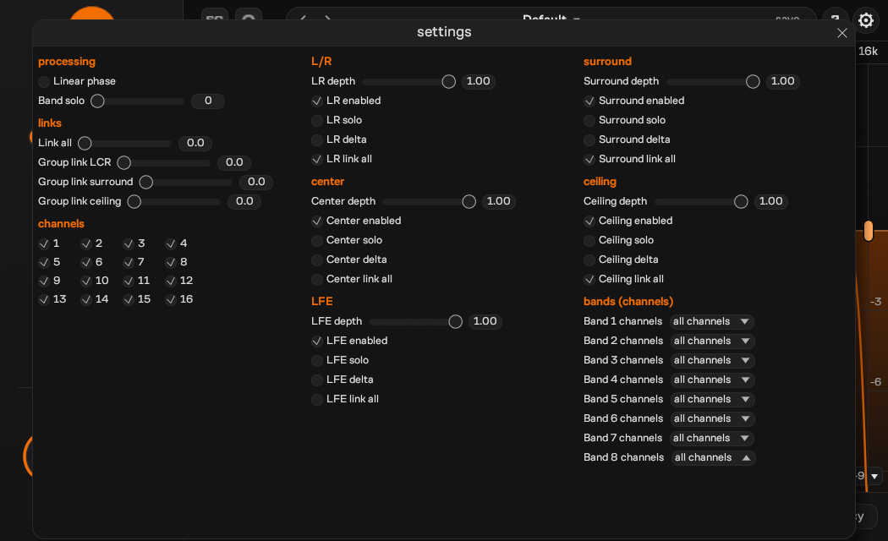
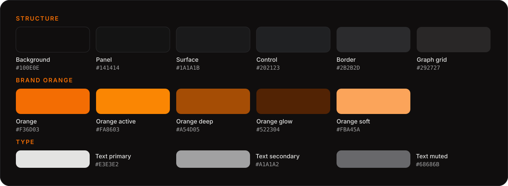

<p align="center">
  
</p>

<p align="center">
  
  
  
  
  
</p>

<p align="center">
  <b>South.air</b> é um supressor dinâmico de ressonâncias da <b>NDERTAL labs</b>.<br>
  Ele encontra e suaviza, em tempo real, as frequências que saltam e incomodam no som.
</p>

<p align="center">
  
</p>

---

## Destaques

| | |
|---|---|
| **Motor validado bit a bit** | Saída idêntica, amostra por amostra, à referência em todos os modos testados (padrão, low latency, high, ultra, delta). |
| **Curva de redução ao vivo** | O gráfico mostra a redução que o motor aplica, quadro a quadro, com o editor aberto. |
| **Bandas editáveis** | Até 8 bandas no gráfico: duplo clique cria, arraste move, roda do mouse muda o Q e duplo clique no nó remove. |
| **Stereo e multicanal** | L/R ou M/S, link, focus e ajustes por canal (L/R, center, LFE, surround, ceiling). |
| **Delta** | Ouça só o que está sendo removido. |
| **Low latency** | Modo de latência baixa para gravar e tocar ao vivo. |
| **Presets** | Aba de presets na barra superior: anterior/próximo, salvar, salvar como e apagar. |

<p align="center">
  
  
</p>

## Instalação

1. Baixe o zip na página de [Releases](../../releases).
2. Copie `South.air.vst3` para `C:\Program Files\Common Files\VST3`.
3. Peça ao seu DAW para procurar plugins novamente. No FL Studio: *Options → Manage plugins → Find more plugins*.

> **Atualizando do Resonia?** Apague `Resonia.vst3` da pasta VST3. O South.air é um plugin novo para o DAW (novo ID), então projetos salvos com o Resonia não o abrem.

### Arquivo do motor

O motor lê um arquivo de dados que **não vem no zip**. Deixe-o em
`D:\PROJETOS\soultree FORK\dumpsooth\nyx_dump.bin` ou indique outro caminho na variável
de ambiente `SOUTHAIR_DUMP`. Sem ele, o plugin só passa o áudio direto.

### Requisitos

- Windows 10/11 x64 e um host VST3 (testado no FL Studio).
- CPU com **AVX2 e FMA**.
- Desempenho medido num Ryzen 5 4600G: para 1 s de áudio a 48 kHz, ~0,2 s no modo padrão e ~0,6 s no ultra. O ultra a 96 kHz pode não acompanhar o tempo real.

## Presets

Ficam em `%APPDATA%\South.air\Presets` como arquivos `.sapreset` de texto, um parâmetro por
linha. *Delta* e *bypass* não entram no preset, porque são controles de monitoração.

## Identidade visual

Preto e grafite como base, com laranja só nos acentos: estados ativos, curva, nós e marca.
Os tokens estão em [`southair/South.air-Redesign-Kit`](southair/South.air-Redesign-Kit).

<p align="center">
  
</p>

## Compilar

Rust estável (MSVC, x86_64) no Windows.

```powershell
cd southair\app
.\make_vst3.cmd
```

O bundle sai em `southair\app\dist\South.air.vst3`. A tela embute fontes, ícones e texturas de
`southair/RECURSOS_VALIDADOS_recuperados`, uma pasta que não está versionada. Sem ela, o build não
fecha.

## Validação

Cada build é comparada à referência num host de teste próprio (`host/`), que aplica os
parâmetros pela interface VST3 e grava a saída. O teste passa só com 100% das amostras
idênticas (`max |dif| = 0`):

| Modo | 44,1 kHz | 48 kHz | 96 kHz |
|---|:---:|:---:|:---:|
| Padrão | ✔ | ✔ | ✔ |
| Low latency | | ✔ | |
| High / Ultra | | ✔ | |
| Low latency + Ultra | | ✔ | |
| Delta | | ✔ | |

Detalhes em [`checks/w_cadeia_m6.md`](checks/w_cadeia_m6.md).

## Estrutura do repositório

| Pasta | Conteúdo |
|---|---|
| `southair/app` | Plugin VST3 e aplicativo de teste (`southair-app`) |
| `southair/South.air-Redesign-Kit` | Kit de identidade: marca, paleta, tokens e referência |
| `lifted`, `lifted_extra` | Motor de áudio |
| `host` | Host VST3 de teste usado na validação |
| `tools` | Ferramentas de tradução e análise |
| `checks`, `docs` | Provas, medições e documentação técnica |
| `port`, `archive` | Trabalho anterior, mantido como histórico |

---

<p align="center">
  <br>
  <sub><b>South.air</b> · NDERTAL labs · build de teste, uso pessoal</sub>
</p>
